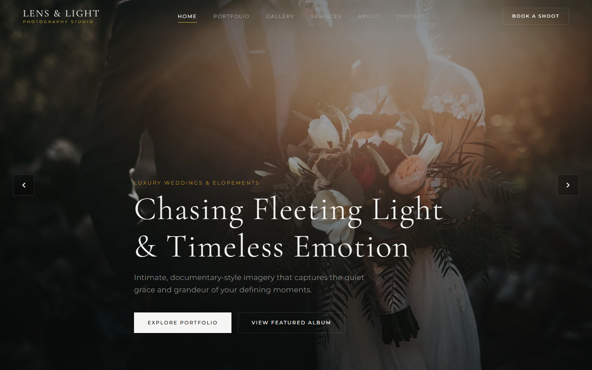
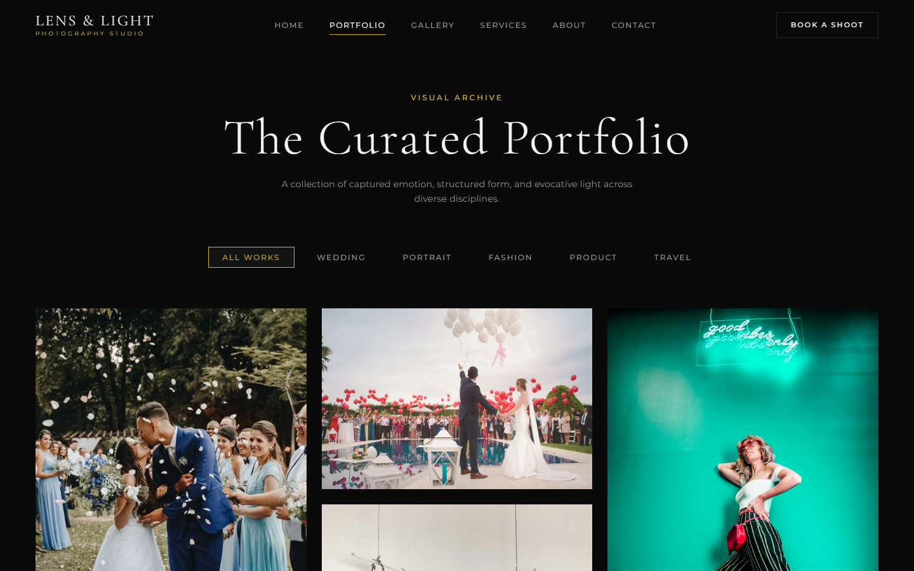
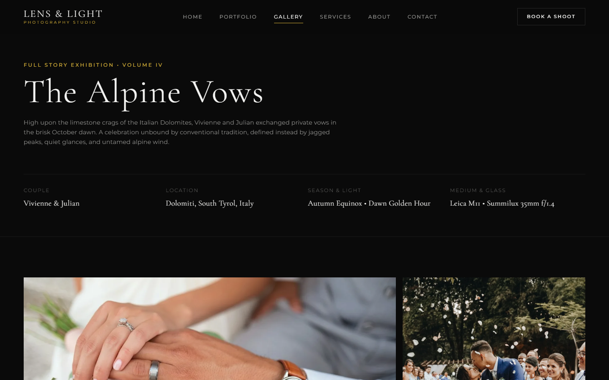
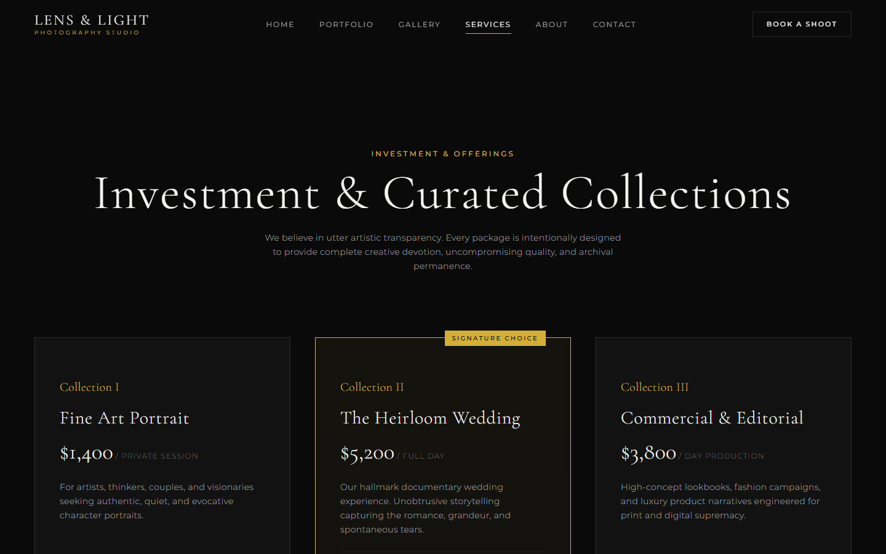
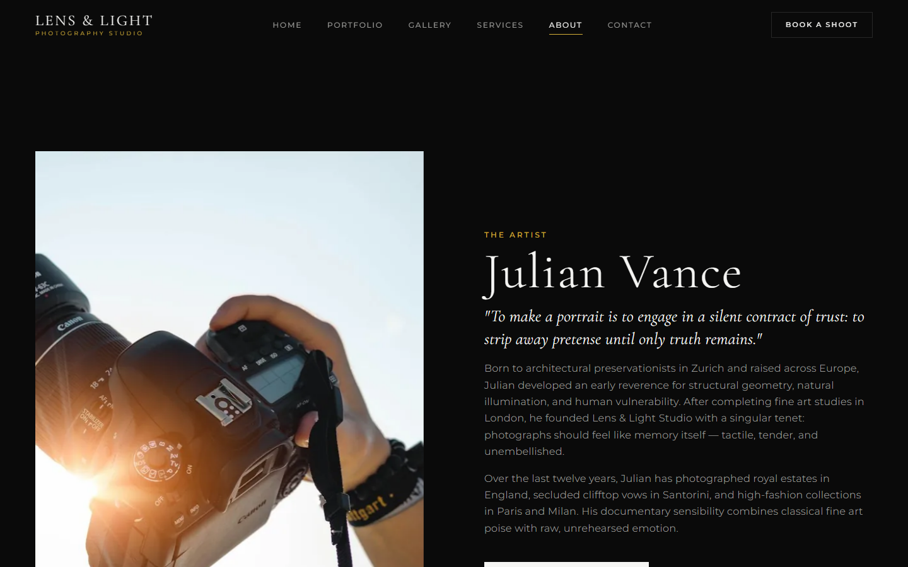
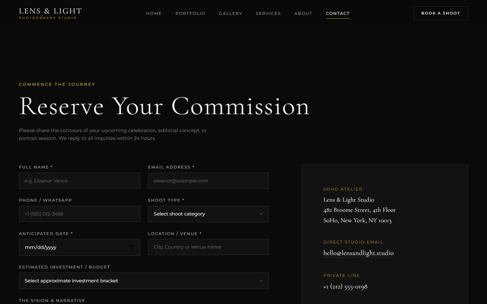

# Lens & Light Studio — Free Photography Website Template (HTML, CSS, JS)

Lens & Light Studio is an image-first, editorial website template handcrafted for fine art, wedding, portrait, and commercial photographers. The photos are the hero; the minimalist black and off-white interface stays out of the way. Built entirely with plain HTML5, CSS3, and modern vanilla JavaScript with zero framework dependencies or build steps.

## Template Preview

### Home Page (Hero Slideshow & Curated Strip)
Full-screen smooth-fade hero slideshow with auto-play, hover-pause, and interactive dots leading into curated stories and testimonials.


### Portfolio Archive (CSS Columns Masonry)
True masonry column grid with instantaneous client-side category filtering across Wedding, Portrait, Fashion, Product, and Travel.


### Full Story Album (The Alpine Vows)
Complete editorial gallery storytelling with metadata breakdown, asymmetrical grid layout, and full-resolution lightbox viewing.


### Services & Investment
Transparent luxury pricing tiers, four-stage creative process timeline, and client inquiry FAQ.


### Biography & Philosophy
Editorial portrait presentation, photographer bio, artistic values, and camera optics atelier breakdown.


### Studio Booking Atelier
High-converting booking inquiry form capturing shoot category, event date, venue location, and estimated budget.


🔗 **View Live Demo**: [https://msg-lens-light-photography-template.netlify.app](https://msg-lens-light-photography-template.netlify.app)

---

## Features

- **Handcrafted Lightbox** — Custom-engineered modal with previous/next controls, keyboard arrow navigation, Escape key closing, mobile touch swipe gestures, and dynamic image counter.
- **Hero Fade Slideshow** — Fullscreen cinematic presentation featuring automated progression, mouse-hover pausing, interactive pagination dots, and directional controls.
- **Masonry Grid with Live Filter** — Pure CSS multi-column layout with instant zero-lag category switching for Wedding, Portrait, Fashion, Product, and Travel.
- **Soft Blur-Up Lazy Loading** — Ultra-smooth progressive loading with low-overhead CSS transitions and native browser lazy-loading below the fold.
- **Universal Rebranding System** — 100% of the studio's color palette, typography, and spacing scale is controlled via CSS variables declared in `:root`.
- **Accessible & Semantic HTML5** — Built with landmark roles, visible `:focus-visible` rings, ARIA labels, form labels, and a dedicated skip-link for keyboard and screen-reader users.
- **Zero Build Step** — Pure standard web technologies; unpack the archive and double-click `index.html` in any modern web browser.
- **Lightweight & High-Performance** — Hand-optimized WebP imagery (under 300 KB each) delivering 90+ Lighthouse Performance and Accessibility scores.

---

## Tech Stack

| Technology | Version | Purpose |
| :--- | :--- | :--- |
| **HTML5** | Modern Living Standard | Semantic document structure, accessibility landmarks, native lazy loading |
| **CSS3** | Modern Standards | CSS Custom Properties (`:root`), CSS Columns Masonry, responsive flexbox/grid |
| **JavaScript (ES6+)** | Vanilla ES2020+ | Custom lightbox engine, touch gestures, hero slideshow, dynamic filtering |
| **Remix Icon** | 4.2.0 (CDN via jsDelivr) | Lightweight SVG vector iconography for UI controls and social links |
| **Google Fonts** | Cormorant Garamond & Montserrat | Elegant editorial serif headings paired with clean, geometric sans-serif body copy |

---

## Quick Start

Download the files and open `index.html` — no install needed.

```bash
# Clone the repository
git clone https://github.com/VAISHNAVI273105/msg-lens-light-photography-template.git

# Navigate into the project folder
cd msg-lens-light-photography-template

# Open in your default browser (macOS/Linux)
open index.html   # or: xdg-open index.html

# On Windows:
start index.html
```

Or serve locally with any static HTTP server:
```bash
python -m http.server 8000
# Visit http://localhost:8000
```

---

## Customization Guide

Rebranding "Lens & Light Studio" requires editing only the `:root` variables in `css/style.css` and the text content in the respective `.html` files.

### 1. Colors & Branding Palette
Open `css/style.css` and adjust the variables under `:root`:

```css
:root {
  /* Brand Palette: Black, Off-White, Champagne Accent */
  --color-bg-primary: #0a0a0a;       /* Main canvas background */
  --color-bg-secondary: #121212;     /* Cards, strips, and footer */
  --color-bg-surface: #171717;       /* Image loading placeholder */
  
  --color-text-primary: #f5f5f3;     /* Main typography color */
  --color-text-secondary: #a3a3a0;   /* Secondary body descriptions */
  --color-text-muted: #737370;       /* Metadata labels and timestamps */
  
  --color-accent: #d4af37;           /* Warm soft champagne gold */
  --color-accent-hover: #e5c158;     /* Button hover state */
  --color-border: rgba(255, 255, 255, 0.12);
}
```

### 2. Typography & Fonts
To change the typography, update the font variables in `css/style.css`:

```css
:root {
  --font-serif: 'Cormorant Garamond', 'Cormorant', Georgia, serif;
  --font-sans: 'Montserrat', -apple-system, BlinkMacSystemFont, sans-serif;
}
```

### 3. Adding New Images to the Portfolio
Add your WebP photos to the `images/` directory and insert a new article element in `portfolio.html`:

```html
<article class="masonry-item blur-load" data-category="wedding" 
         data-lightbox data-lightbox-src="images/your-photo.webp" 
         data-caption="Your Photo Caption — Location" tabindex="0">
  <div class="masonry-image">
    
  </div>
  <div class="masonry-overlay">
    <span class="masonry-category">Wedding</span>
    <h2 class="masonry-title">Title of the Work</h2>
  </div>
</article>
```

---

## Frequently Asked Questions (FAQ)

### How do I add a new album to the website?
Duplicate `gallery.html` to a new file (e.g. `gallery-tuscany.html`). Update the album header, story narrative, and photo grid with your new WebP images. In `portfolio.html` and `index.html`, update the link to point to your new album file.

### How do I change or add new portfolio categories?
In `portfolio.html`, add a new button in `.portfolio-filters` with `data-filter="yourcategory"`. Then assign `data-category="yourcategory"` to any `.masonry-item` elements you want grouped under that filter. The script automatically handles active states and filtering.

### Are the images optimized for web performance?
Yes. All included stock photographs are formatted as modern WebP files and compressed to strictly under 300 KB each (averaging 50–120 KB), with below-the-fold assets using native `loading="lazy"` to ensure instantaneous initial paint and 90+ Lighthouse scores.

---

## Image Credits & Licensing

All photography used in this template is free for commercial and editorial use under the Unsplash License:

- Hero Slides: Wedding Couple by Nathan Dumlao; Editorial Portrait by Houcine Ncib; Alpine Lake by Luca Bravo.
- Wedding & Ceremonies: Photos by Alif Ngoylung, Scott Webb, and Jeremy Wong.
- Portraits: Studio Portraits by Jurica Koletić, Michael Dam, and Daniil Lobachev.
- Fashion & Haute Couture: Editorial captures by Tamara Bellis, Laura Chouette, and Dom Hill.
- Product & Still Life: Campaigns by C-Care, Joanna Kosinska, and The 5TH.
- Expeditions & Landscapes: Expeditions by Kalen Emsley, Dino Reichmuth, and Sean Oulashin.
- Atelier & Photographer: Studio craft portraits by Paul Hanaoka.

---

## Deployment

### Option A: Netlify (Recommended)
1. Fork or push this repository to your GitHub account.
2. Sign in to [Netlify](https://app.netlify.com).
3. Select **Add new site** &rarr; **Import an existing project** &rarr; choose **GitHub**.
4. Select `msg-lens-light-photography-template`.
5. Leave the build command and publish directory blank (or `.`), then click **Deploy Site**.

### Option B: Drag & Drop
Drag the root project folder directly into the Netlify Drop dashboard at [https://app.netlify.com/drop](https://app.netlify.com/drop).

---

## License

MIT License &copy; 2026 Lens & Light Studio. Free to use for personal and commercial projects.
